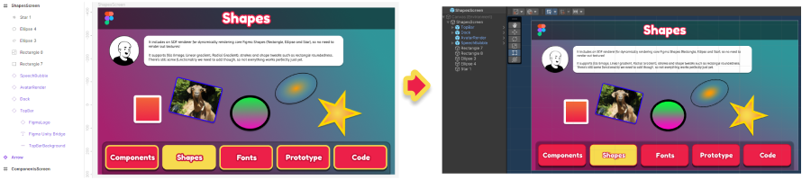
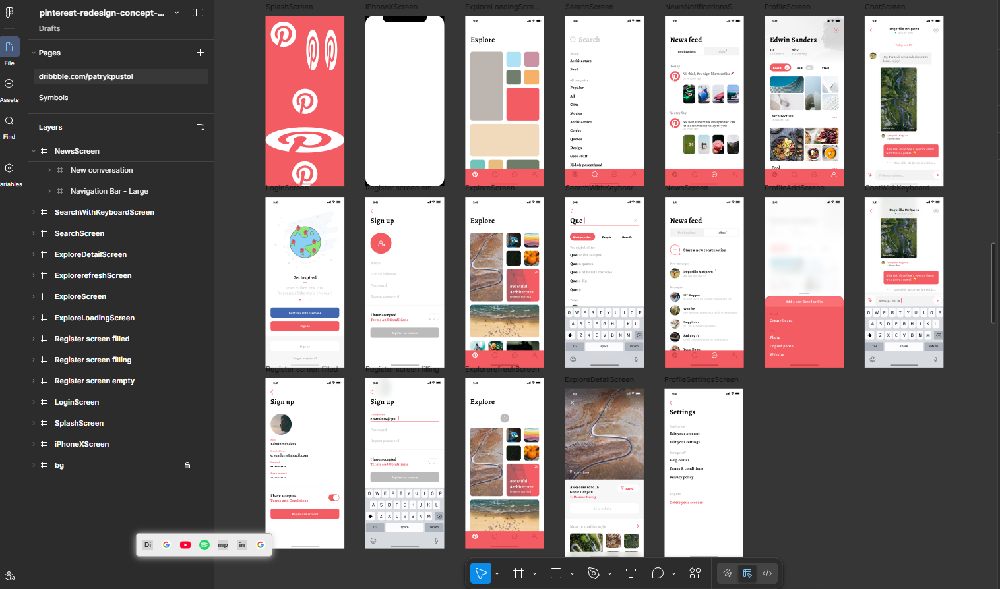
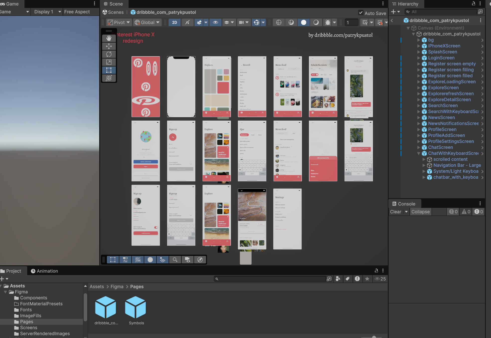
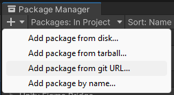
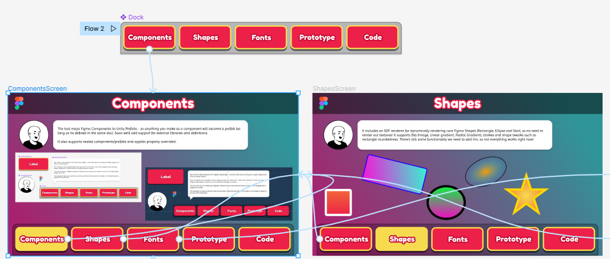
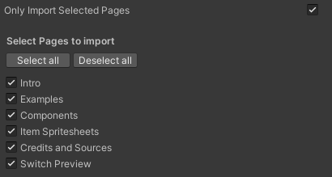
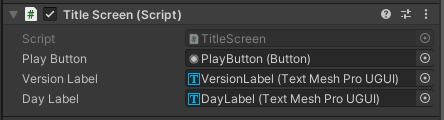
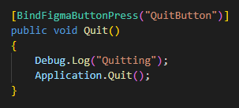

# Unity Figma Bridge



> Fork maintained by [Bilal Arıkan](https://github.com/bilal-arikan), based on the original
> [UnityFigmaBridge by Simon Oliver](https://github.com/simonoliver/UnityFigmaBridge).
> Adds offline caching, placeholder images, smarter binding, configurable asset folders and a Prefab Health Check
> ([PR #60](https://github.com/simonoliver/UnityFigmaBridge/pull/60)).

Easily bring your Figma documents, components, assets and prototypes to Unity as native Unity UI — great for game jams
and quick prototyping. Tested on **Unity 2021.3+**.

**Links:** [WebGL Demo](https://simonoliver.itch.io/unity-figma-bridge) ·
[Figma Community file](https://www.figma.com/community/file/1230440663355118588/Figma-Unity-Bridge-Example) ·
[Example Unity Project](https://github.com/simonoliver/UnityFigmaBridgeExample)

## Example

A Figma document imported into Unity as native UI with a single sync:

| Figma source | Unity result |
|--------------|--------------|
|  |  |

## Features

* Recreates core Figma elements as native Unity objects
* Recreates prototype flows (including Sections) and components as linked prefabs
* SDF renderer for core shapes, server-side rendering of vectors
* Responsive layout, safe areas and (experimental) auto layout
* Auto-generated font assets (downloads missing fonts from Google Fonts)
* Binds MonoBehaviours, fields and button presses to Figma objects

**Added in this fork:** offline support & caching · placeholder images · smart field binding · rule-based component
binding · screen enhancement · configurable asset folder · Prefab Health Check.

## Setting up



1. Package Manager → **Add package from git URL** → `https://github.com/bilal-arikan/UnityFigmaBridge.git`
2. Project Settings → **Figma Bridge** → **Create** a settings asset
3. Paste your Figma document URL (`https://www.figma.com/file/.../...`)
4. Add your [Figma Personal Access Token](https://www.figma.com/developers/api#authentication) (Settings → Account)
5. If needed, import TMP Essentials (Window → Text Mesh Pro → Import TMP Essential Resources)

## Syncing

Use the **Figma Bridge** menu:

| Menu item | Action |
|-----------|--------|
| **Sync ALL** | Full sync — document + all assets (recommended first run) |
| **Reprocess Cached Document** | Regenerate from local cache, fully offline |
| **Sync Document (No Image)** | Document structure only, no images |
| **Download Server Rendered Images** | Re-download vector renders (rate-limited) |
| **Download Image Fills** | Re-download image fills (rate-limited) |
| **Prefab Health Check** | Scan project for variant / reference issues |

You'll be asked to confirm your access token and whether to use the current scene for prototype flow.

## Offline support & placeholders

* **Offline workflow** — once synced, **Reprocess Cached Document** regenerates everything from the local cache with no
  network access.
* **Placeholder images** — failed downloads produce a 2×2 gray placeholder so the UI never breaks; re-run a download
  menu item to replace placeholders with real images. Handy against Figma's 429 rate limits.

## Prototyping



The importer recreates the prototype flow from the Figma file. Disable **Build Prototype Flow** to only generate assets.
[Figma Sections](https://help.figma.com/hc/en-us/articles/9771500257687-Organize-your-canvas-with-sections) are
supported, and active screens per section are remembered during play.

## Selecting pages



Enable **Select Pages to import** to pick which pages get imported. Unselected pages still generate components (in case
they're reused), but skip screens, image fills and server renders.

## How Figma maps to Unity

| Node type | Unity mapping |
|-----------|---------------|
| **Frames** (page root) | A "screen" prefab in *Screens* |
| **Image fills** | PNG sprites in *ImageFills* |
| **Components** | Prefabs in *Components* (instances apply overrides) |
| **Pages** | Full-page prefabs in *Pages* |
| **Vectors** | Server-rendered PNGs |

The asset root defaults to `Assets/Figma` and can be changed via the **Figma Assets Root Folder**
(`FigmaAssetsRootFolder`) setting; all sub-folders are created relative to it.

## Binding behaviours



At sync time the importer auto-attaches behaviours via reflection so you don't re-add them after each sync:

* A MonoBehaviour whose name matches an object's name (case-insensitive) is attached automatically.
* Serializable fields are matched to child objects by name (depth 2).

**Advanced field binding** matches field names flexibly:
* Case-insensitive exact match (`MyButton` → `mybutton`)
* Normalized match ignoring spaces/dashes/underscores (`My_Play_Button` → `My Play Button`)
* Underscore-prefixed fields (`m_ScoreLabel` → `ScoreLabel`)



* `[[BindFigmaButtonPress("PlayButton")]]` on a method adds an onClick listener to that button (depth 2).
* Objects named with "Button" / "SafeArea" get the matching component automatically. Buttons use a child named
  "selected" for the rollover state.

**Rule-based component binding** — enable **Add Special Behaviours** (`EnableAddSpecialBehaviours`) to attach components
by node-name filter. Default rules: `Button`→`button`, `Image`→`image`, `TextMeshProUGUI`→`text`,
`TMP_InputField`→`inputfield`, `Toggle`→`toggle`, `SafeArea`→`safearea`. Editable in the settings file.

## Standalone screens

Enable **Enhance Screens With UI Components** (`EnhanceScreensWithUIComponents`) to add Canvas, CanvasScaler and
GraphicRaycaster to generated screens (sized to the Figma screen) so a screen prefab is usable on its own.

## Prefab Health Check

**Figma Bridge → Prefab Health Check** scans for Figma variants, missing references and orphaned variants. Also
available as a scripting API:

```csharp
var result   = PrefabHealthChecker.RunFullScan();
var variants = PrefabHealthChecker.ScanFigmaVariants();
var missing  = PrefabHealthChecker.ScanMissingReferences();
var orphaned = PrefabHealthChecker.ScanOrphanedVariants();
```

## Other notes

* **Fonts** — missing fonts are downloaded from Google Fonts and converted to TMP; falls back to the best name/weight
  match in your project. A custom shader (`Fima/TextMeshPro`) is used for "outside" stroke positioning.
* **Server rendering** — vector shapes, vector-only frames, or nodes whose name contains "render" are rendered server
  side at *Server Render Image Scale* (default 3).
* **Exporting** — nodes marked for export are written as PNGs to a path matching their name (e.g. `Textures/Icon/GameIcon`).
* **Color space** — Gamma & Linear supported; textures must have sRGB checked (automatic since 1.0.8).
* **Dependencies** — TextMeshPro 2.0.1, JSON.Net 2.01 (imported automatically).
* Change the access token via **Figma Bridge → Set Personal Access Token**.

## Currently unsupported

Image tweaks (exposure/contrast), shadow blur, ellipse sweep, most effects, multiple fills, advanced stroke
styles/positions, device fonts, video fills, complex star/polygon shapes, boolean ops, line/arrow, consistent UUIDs,
"Scale" constraint.

## Credits

Original project by [Simon Oliver](https://github.com/simonoliver); fork maintained by
[Bilal Arıkan](https://github.com/bilal-arikan). Uses
[Iñigo Quílez' 2D SDF functions](https://iquilezles.org/articles/distfunctions2d/),
[krzys-h's UnityWebRequestAwaiter](https://gist.github.com/krzys-h/9062552e33dd7bd7fe4a6c12db109a1a) and
[Jonathan Neal's google-fonts-complete](https://github.com/jonathantneal/google-fonts-complete).

## Contributing

PRs and issues welcome on the [fork repository](https://github.com/bilal-arikan/UnityFigmaBridge). For the original
project, reach Simon Oliver on 🐤[Twitter](https://twitter.com/simonoliveruk) or
🐘[Mastodon](https://mastodon.gamedev.place/@simonoliver).
